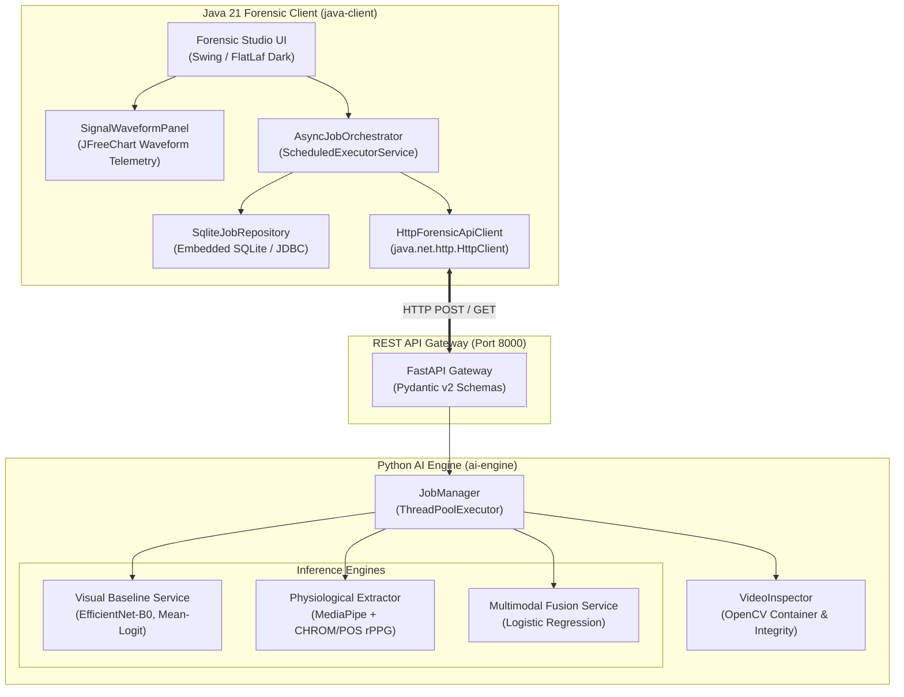
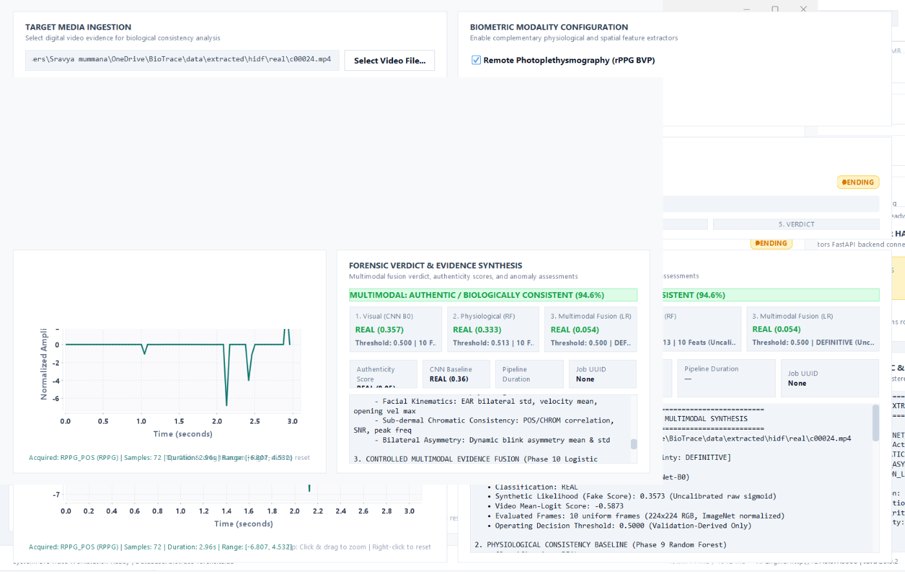
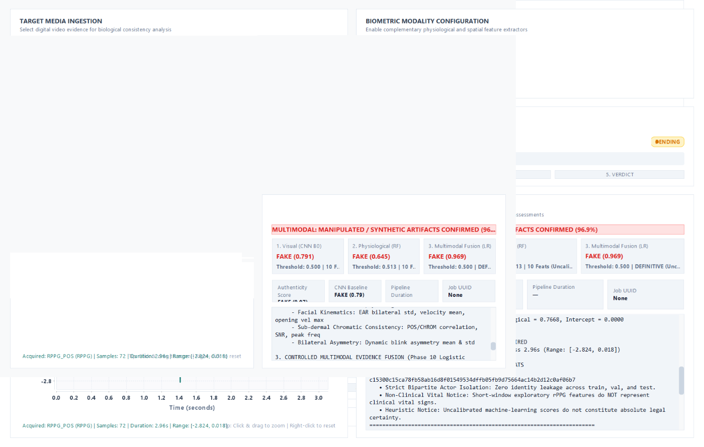

# BIOTrace: Biological Intelligence & Multimodal Media Authenticity

[](https://openjdk.org/)
[](https://www.python.org/)
[](https://fastapi.tiangolo.com/)
[](https://pytorch.org/)
[](https://maven.apache.org/)
[](LICENSE)
[](#8-testing--verification)

> **BIOTrace** is an open-source biological intelligence and multimodal media authenticity platform designed to detect synthetic and manipulated facial media (deepfakes, face swaps, generative diffusion). It combines deep convolutional visual representations with remote photoplethysmography (rPPG) and facial kinematic dynamics under strict, zero-leakage bipartite actor isolation.

---

## Table of Contents
1. [Scientific Motivation & Core Hypothesis](#1-scientific-motivation--core-hypothesis)
2. [Key Implemented Capabilities](#2-key-implemented-capabilities)
3. [System Architecture](#3-system-architecture)
4. [Empirical Benchmark Results](#4-empirical-benchmark-results)
5. [User Interface & Visual Evidence](#5-user-interface--visual-evidence)
6. [Technology Stack](#6-technology-stack)
7. [Installation & Quickstart](#7-installation--quickstart)
8. [Testing & Verification](#8-testing--verification)
9. [Documentation & Research Reports](#9-documentation--research-reports)
10. [Authorship & License](#10-authorship--license)
11. [Citation](#11-citation)

---

## 1. Scientific Motivation & Core Hypothesis

State-of-the-art generative video models and deepfake algorithms can fabricate photorealistic spatial facial textures with microscopic fidelity. However, natural human biology operates under strict physiological and temporal constraints that generative architectures struggle to synthesize consistently:

- **Subcutaneous Blood Volume Pulse (rPPG)**: Cardiac systolic and diastolic phases induce subtle, periodic chrominance shifts in facial skin tissue. In synthetic videos, generative blending, frame warping, and boundary Poisson reconstruction disrupt pulse wave continuity.
- **Facial Kinematics & Eye Dynamics**: Human blinks and ocular movements follow constrained kinematic velocity profiles characterized by the Eye Aspect Ratio (EAR). Generative face reenactments frequently exhibit unnatural opening/closing velocities, temporal jitter, or omitted blinks.
- **Bilateral Asymmetry**: Biological facial motion is coordinated yet naturally asymmetric across facial hemispheres. Synthetic replacements often distort bilateral dynamic synchrony.

### The Research Question:
> *Can multimodal physiological and temporal facial evidence provide complementary information to visual convolutional models for detecting manipulated videos under strict, identity-isolated evaluation?*

---

## 2. Key Implemented Capabilities

### 🔬 Multi-Tiered Detection Pipeline
- **Phase 6 Visual Baseline**: Fine-tuned EfficientNet-B0 backbone with video-level mean-logit pooling across 10 uniformly sampled frames ($224 \times 224$ RGB, ImageNet normalization).
- **Phase 9 Physiological Baseline**: Random Forest classifier evaluating a curated 10-feature vector spanning continuous EAR kinematics, exploratory short-window rPPG (CHROM vs. POS), and bilateral ocular asymmetry.
- **Phase 10 Multimodal Fusion**: L2-regularized Logistic Regression model combining standardized visual logit representations with physiological probability predictions.

### 🖥️ Forensic Studio Desktop Workstation
- **Java 21 Swing Desktop UI**: Powered by the **FlatLaf Dark** theme and cyber-forensic color system.
- **Interactive Physiological Telemetry**: Integrated **JFreeChart** waveform panel (`SignalWaveformPanel`) rendering real-time rPPG pulse waveforms (CHROM & POS) alongside Eye Aspect Ratio trajectories.
- **Audit Logging & History**: Embedded SQLite database (`SqliteJobRepository`) preserving full provenance, execution timestamps, model parameters, and video-level verdicts.
- **Non-Blocking Concurrency**: Multithreaded asynchronous orchestrator (`AsyncJobOrchestrator`) keeping the UI responsive during intensive inference.

---

## 3. System Architecture

BIOTrace features a decoupled two-tier architecture communicating over an asynchronous HTTP/REST gateway:



For complete technical specifications, see [docs/ARCHITECTURE.md](docs/ARCHITECTURE.md).

---

## 4. Empirical Benchmark Results

All evaluations were conducted on the **HiDF** dataset under **Protocol C**:
- **Frozen Manifest SHA-256**: `c15300c15ca78fb58ab16d8f01549534dffb05fb9d75664ac14b2d12c0af06b7`
- **Bipartite Actor Isolation**: Zero identity overlap between training ($N = 6,106$), validation ($N = 1,308$), and held-out test ($N = 1,308$) partitions.
- **Held-Out Test Set**: 654 authentic videos, 654 manipulated videos.

### Comparative Evaluation Metrics
| Model | Operating Threshold ($\theta$) | ROC-AUC (95% CI) | PR-AUC | Accuracy (%) | Precision | Recall | F1 Score | Equal Error Rate (EER) | Brier Score |
| :--- | :---: | :---: | :---: | :---: | :---: | :---: | :---: | :---: | :---: |
| **Visual Baseline**<br>*(Phase 6 EfficientNet-B0)* | $0.5343^*$<br>$0.5000$ | $0.7821$<br>$(0.7571, 0.8054)$ | $0.7550$ | $71.64\%$<br>$72.25\%$ | $0.7180$<br>$0.6969$ | $0.7125$<br>$0.7875$ | $0.7153$<br>$0.7394$ | $28.13\%$ | $0.1991$ |
| **Physiological Baseline**<br>*(Phase 9 Random Forest)* | $0.5128^*$<br>$0.5000$ | $0.6267$<br>$(0.5975, 0.6581)$ | $0.6117$ | $58.33\%$<br>$57.95\%$ | $0.5832$<br>$0.5737$ | $0.5841$<br>$0.6193$ | $0.5837$<br>$0.5956$ | $41.67\%$ | $0.2380$ |
| **Multimodal Fusion**<br>*(Phase 10 Logistic Regression)* | $\mathbf{0.4999^*}$<br>$0.5000$ | $\mathbf{0.7952}$<br>$\mathbf{(0.7713, 0.8188)}$ | $\mathbf{0.7799}$ | $\mathbf{72.17\%}$<br>$72.09\%$ | $\mathbf{0.7224}$<br>$0.7220$ | $\mathbf{0.7202}$<br>$0.7187$ | $\mathbf{0.7213}$<br>$0.7203$ | $\mathbf{27.83\%}$ | $\mathbf{0.1866}$ |

$^*$ *Operating threshold optimized strictly on the validation partition.*

### Key Scientific Findings:
- **Modest Empirical Gain**: Multimodal fusion improves ROC-AUC by **+0.0132** (+1.32%) and PR-AUC by **+0.0249** (+2.49%) over the standalone visual baseline, reducing calibration Brier score from 0.1991 to 0.1866.
- **Statistical Significance (Bootstrap $B = 10,000$)**: The 95% bootstrap confidence interval for $\Delta \text{ROC-AUC}$ is $[-0.0007, +0.0274]$ ($p = 0.969$ one-tailed). Because the two-tailed interval slightly crosses zero, the improvement is **modest and not statistically decisive**.
- **Error Recovery**: In 224 cases where the visual baseline failed, the physiological model was correct; multimodal fusion successfully recovered **104 of these visual failure cases** (net gain of $+7$ cases).
- **Physical Caveat**: Video duration (~2.96 seconds) imposes a Rayleigh frequency resolution limit of $\Delta f \approx 0.338\,\text{Hz} \approx 20.3\,\text{BPM}$. Extracted rPPG metrics represent exploratory short-window chromatic consistency rather than clinical vital signs.

For complete research methodology and in-depth error interaction analyses, see [docs/RESEARCH_METHODOLOGY.md](docs/RESEARCH_METHODOLOGY.md) and [docs/RESULTS_AND_LIMITATIONS.md](docs/RESULTS_AND_LIMITATIONS.md).

---

## 5. User Interface & Visual Evidence

### Authentic Video Forensic Analysis
Forensic Studio evaluating a verified authentic video sample:


### Manipulated (Deepfake) Video Forensic Analysis
Forensic Studio detecting synthetic facial manipulation:


---

## 6. Technology Stack

### Java 21 Forensic Client (`java-client/`)
- **Runtime**: Java 21 LTS (tested with JDK 26, bytecode release target 21)
- **Build System**: Apache Maven 3.9+
- **Look-and-Feel**: FlatLaf Dark 3.4
- **Visualization**: JFreeChart 1.5.4
- **Persistence**: SQLite JDBC 3.45.1
- **JSON Processing**: Jackson Databind 2.16.1

### Python AI Engine (`ai-engine/`)
- **Runtime**: Python 3.11–3.13
- **REST Framework**: FastAPI 0.110+, Uvicorn 0.28+
- **Deep Learning**: PyTorch 2.2+, Torchvision 0.17+
- **Computer Vision**: OpenCV (`cv2`, contrib) 4.9+, MediaPipe 1.2+ (Tasks API)
- **Face Landmarking**: MediaPipe Tasks `FaceLandmarker` via `biotrace.vision.mediapipe_compat`
- **Machine Learning & Signals**: scikit-learn 1.4+, SciPy 1.10+, NumPy 1.26+, joblib 1.3+
- **Data Schemas**: Pydantic v2.6+

---

## 7. Installation & Quickstart

### Prerequisites

- JDK 21 or newer, available on `PATH` or through `JAVA_HOME`.
- Apache Maven on `PATH`.
- Python 3.11–3.13 with pip.
- Git to clone the repository.

### Get BioTrace with Git

For a first-time checkout, run these commands in Windows Command Prompt, PowerShell, or macOS Terminal:

```text
git clone https://github.com/SravyaMummana2006/BioTrace.git
cd BioTrace
```

If you already cloned BioTrace, open a terminal in the BioTrace folder and pull updates:

```text
git pull --ff-only
```

Run the setup and launch commands below from the BioTrace folder.

### Windows

One-time setup in PowerShell (shown with Python 3.13):

```powershell
py -3.13 -m venv .venv
.\.venv\Scripts\python.exe -m pip install -r ai-engine/requirements.txt
.\.venv\Scripts\python.exe scripts/download_models.py
```

Start BioTrace with one command in PowerShell or Command Prompt:

```powershell
.\run_workstation.bat
```

You can also double-click `run_workstation.bat` in File Explorer.

### macOS (Apple Silicon)

One-time setup (use a supported Python version):

```bash
python3 -m venv .venv
.venv/bin/python -m pip install -r ai-engine/requirements.txt
.venv/bin/python scripts/download_models.py
```

Start BioTrace with one command:

```bash
./run_workstation.sh
```

On both platforms, the launcher starts the FastAPI backend on a free loopback port, waits for its health check, and opens the Java desktop client. Closing the desktop client stops the backend started by that launcher. Use the same command for subsequent launches.

The model setup script downloads the MediaPipe face landmarker and checks the included visual, physiological, and fusion model artifacts. To verify the assets again, run `scripts/download_models.py --check` with the virtual environment's Python.

---

## 8. Testing & Verification

The repository contains an exhaustive automated test suite covering unit, domain, service, API, and live end-to-end integration workflows.

### Python Test Suite
```bash
cd ai-engine
python -m pytest tests -q
```
*Verified on macOS Apple Silicon (Python 3.13, MediaPipe 1.2.3): **285 passed, 8 skipped, 10 failed**. The remaining failures require external research artifacts that are intentionally not committed: the HiDF dataset (`data/extracted/hidf`), derived fusion score caches, and the historical frozen-manifest digest expectations. The manifest, audit, and metric files themselves resolve from `reports/data/`.*

### Java Test Suite
```bash
cd java-client
mvn test
```
*Verified on macOS: **61 tests, 57 passed, 9 skipped, 4 failed**. Three failures require HiDF fixture videos under `data/extracted/hidf/`; one is a font-family assertion (`Segoe UI`) that does not hold on macOS, where the JVM substitutes `Dialog`. The live workstation workflow passes separately against a running backend.*

---

## 9. Documentation & Research Reports

Detailed technical documentation and phase evaluation reports:
- [docs/ARCHITECTURE.md](docs/ARCHITECTURE.md) — Comprehensive software architecture, service diagrams, and data contracts.
- [docs/RESEARCH_METHODOLOGY.md](docs/RESEARCH_METHODOLOGY.md) — Protocol C split, bipartite actor isolation, and feature extraction mathematics.
- [docs/RESULTS_AND_LIMITATIONS.md](docs/RESULTS_AND_LIMITATIONS.md) — Experimental evaluation metrics, bootstrap significance, error interaction analysis, and validity limits.
- [Phase 10 fusion report](reports/history/phase10_fusion_report.md) — Phase 10 multimodal fusion experiment log and full parameter disclosure.
- [Final application acceptance report](reports/history/final_application_acceptance_report.md) — End-to-end integration verification report and UI acceptance checklist.

Research artifacts are grouped to keep the repository root focused:
- `reports/history/` — phase reports, audits, design notes, and verification logs.
- `reports/data/` — metrics JSON, manifests, distributions, and cryptographic hash records.
- `reports/screenshots/` — UI evidence figures.

---

## 10. Authorship & License

### Author & Maintainer
**Sravya Mummana**  
GitHub: [@SravyaMummana2006](https://github.com/SravyaMummana2006)  
Project Repository: [https://github.com/SravyaMummana2006/BioTrace](https://github.com/SravyaMummana2006/BioTrace)

### License
This project is licensed under the **MIT License** — see the [LICENSE](LICENSE) file for complete terms and third-party notices.

---

## 11. Citation

If you utilize BIOTrace in your research, academic benchmarks, or digital forensics tooling, please cite this repository using the metadata below:

```bibtex
@software{Mummana_BIOTrace_2026,
  author = {Mummana, Sravya},
  title = {{BIOTrace: Biological Intelligence \& Multimodal Media Authenticity}},
  url = {https://github.com/SravyaMummana2006/BioTrace},
  version = {1.0.0},
  year = {2026}
}
```
Or refer to the machine-readable [CITATION.cff](CITATION.cff) file.
