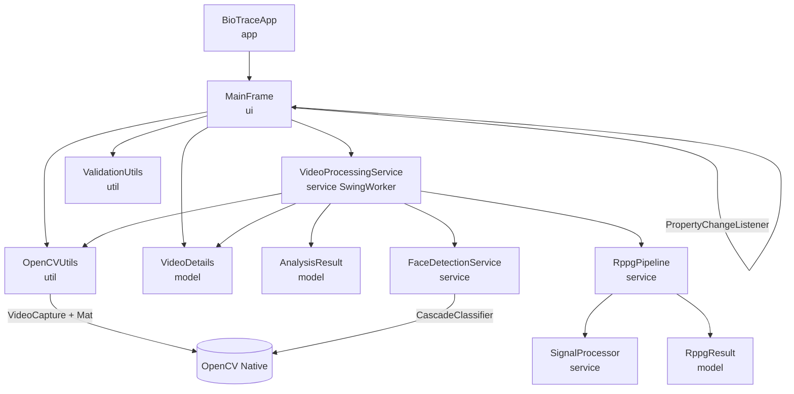

# BioTrace — Biological Consistency-Based Deepfake Detection

A Java 21 desktop application that investigates potential deepfake videos  
through real OpenCV-based frame extraction and biological/temporal consistency analysis.

---

## Architecture



---

## Prerequisites

| Requirement | Notes |
|---|---|
| **Java 21+** | JDK 21 or later (`java -version`) |
| **Maven** | 3.9+ recommended; also works with the bundled Maven wrapper |
| Internet access (first run) | Maven downloads ~110 MB OpenCV JAR which includes bundled native libs |

> No separate OpenCV native installation is needed. The `org.openpnp:opencv:4.9.0-0`  
> Maven artifact bundles the platform-native `.dll`/`.so`/`.dylib` and extracts them  
> automatically at startup via `nu.pattern.OpenCV.loadLocally()`.

---

## Build

```bash
# from the BioTrace/ directory
mvn clean install -DskipTests
```

---

## Run

```bash
mvn exec:java
```

Or with the fat-jar (produced by `mvn package`):

```bash
java -jar target/biotrace-1.0-SNAPSHOT-jar-with-dependencies.jar
```

---

## Test

```bash
mvn test
```

Expected output:
```
Tests run: 24, Failures: 0, Errors: 0, Skipped: 0
BUILD SUCCESS
```

### Test coverage

| Class | Tests | Notes |
|---|---|---|
| `ValidationUtilsTest` | 6 | null, non-existent, directory, bad ext, all 4 valid exts, case-insensitive |
| `OpenCVUtilsTest` | 7 | `formatDuration` edge cases, library state |
| `VideoDetailsTest` | 4 | defaults, setters/getters, file size, filename |
| `SignalProcessorTest` | 6 | detrending, normalisation, FFT dominant freq, hzToBpm, constant signals, bounds |
| `RppgPipelineTest` | 3 | short signal, degenerate signal, synthetic pulse validation |

> **Video-fixture note:** Tests that require a real video file are intentionally  
> omitted from the automated suite because no fixture can be assumed in CI.  
> To manually test OpenCV decoding, run the app and select any `.mp4` / `.avi` /  
> `.mkv` / `.mov` file. If you want to add fixture-based tests, place a small  
> `test.mp4` under `src/test/resources/fixtures/` and read its path with  
> `getClass().getResource("/fixtures/test.mp4").getFile()`.

---

## Reproducible Validation Procedure (Prompt 4)

To validate the rPPG heart rate estimation against a reliable reference:

1. **Setup & Consent**: Ensure you have consenting adult participants. Obtain permission for video capture and processing.
2. **Environment**: Ensure the face is well-lit with minimal shadows. Use a stationary camera.
3. **Reference Device**: Use a pulse oximeter (e.g. finger clip) or a reliable ECG/chest-strap monitor.
4. **Recording**: 
   - Start the reference device.
   - Record a 15–60 second video of the participant's face.
   - Ask the participant to remain relatively still.
5. **Processing**: Load the video into the BioTrace application and note the estimated BPM and Quality score.
6. **Comparison**:
   - Compare the BioTrace BPM estimate against the reference BPM.
   - Calculate Mean Absolute Error (MAE) and Root Mean Squared Error (RMSE) across a dataset of several recordings.
7. **Reporting**: Document the number of recordings, lighting conditions, error rates (MAE, RMSE), valid-estimate coverage (percentage of recordings yielding a GOOD/LOW quality estimate), and the complete failure rate.

*Note: Empirical validation using this procedure has not yet been performed on a large dataset. No medical claims are made.*

---

## How the app works (Prompt 2, 3 & 4 implementation)

1. **Library loading** — `BioTraceApp` calls `OpenCVUtils.loadLibrary()` before  
   showing the UI. The app starts even if OpenCV fails.
2. **File selection** — `JFileChooser` opens; `ValidationUtils` checks existence, readability, and extension.
3. **Metadata probe** — `OpenCVUtils.populateVideoMetadata()` opens `VideoCapture` to verify codec.
4. **Face & ROI Tracking** — `VideoProcessingService` loops through frames, using `FaceDetectionService` (Haar cascade) to find the largest face. It extracts the forehead ROI and computes spatial RGB means. Applies a zero-order hold on missing detections to prevent irregular sampling.
5. **rPPG Analysis** — `RppgPipeline` processes the RGB means. It applies CHROM colour-space projection (de Haan & Jeanne 2013), OLS detrending, variance normalisation, and a 2nd-order Butterworth bandpass filter.
6. **Heart Rate Estimation** — `SignalProcessor` computes an FFT with a Hann window, finds the dominant frequency in the human pulse band (0.7-3.0 Hz), calculates an SNR proxy, and derives BPM.
7. **Results UI** — The analysis summary reports real statistics, SNR-based signal quality, and experimental HR.
8. **Visual Diagnostics** — The `MainFrame` plots Raw RGB Traces, the filtered rPPG signal, and the Power Spectrum using JFreeChart.

---

## Feature checklist (Prompt 4)

- [x] Incorrect handling of dropped frames and irregular sampling fixed (Zero-order hold applied)
- [x] Diagnostic arrays (Raw RGB, processed, spectrum) added to `RppgResult`
- [x] JFreeChart integration added to `MainFrame` in a tabbed panel
- [x] Raw RGB traces, Processed rPPG signal, and Power Spectrum plotted
- [x] Reproducible validation procedure documented
- [x] Automated tests added for constant signals and FFT bounds
- [x] 26 JUnit tests — all pass
- [x] Explicit limitations mentioned; no fabricated clinical data used
