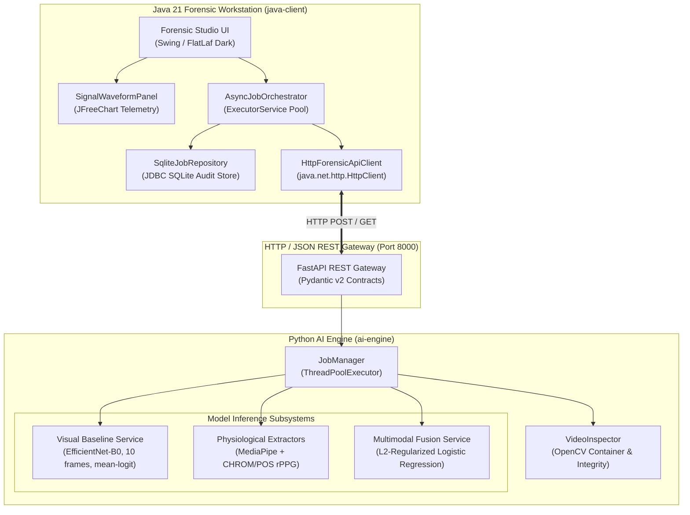
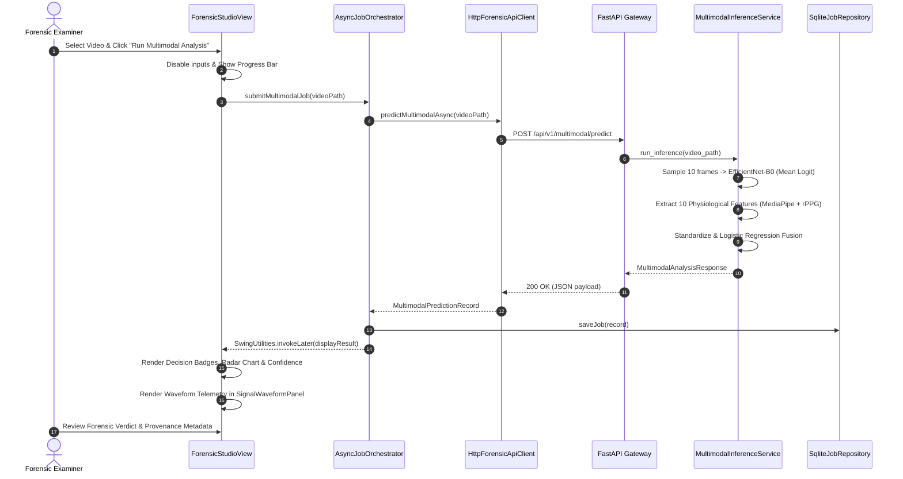

# BIOTrace Architecture & System Design

BIOTrace is engineered as a decoupled, multi-tiered forensic analysis platform combining a high-performance **Python FastAPI** AI backend with a scientific **Java 21 Swing** workstation desktop client.

---

## 1. High-Level Architectural Overview



---

## 2. Desktop Client Architecture (`java-client/`)

The desktop client provides forensic examiners with an interactive, responsive graphical environment tailored for deepfake inspection and physiological telemetry review.

### 2.1 UI Layer & Theme
- **UI Framework**: Java Swing augmented with the **FlatLaf Dark** modern look-and-feel.
- **Theme System (`ForensicTheme.java`)**: Strict cyber-forensic color palette featuring deep surface blues (`#0D1117`, `#161B22`), crisp typography, border styling, and alert color-coding (Cyan for authentic, Amber for warning, Crimson for synthetic manipulation).
- **Primary Views**:
  - `ForensicStudioView`: Primary analysis workstation containing video path selectors, real-time job execution buttons, visual baseline cards, physiological feature cards, and the comprehensive multimodal fusion verdict dashboard.
  - `SignalWaveformPanel`: Interactive physiological telemetry chart powered by **JFreeChart**, rendering remote photoplethysmography (POS vs. CHROM pulse waves) and Eye Aspect Ratio (EAR dynamic trajectory) side-by-side.
  - `HistoryView`: Chronological audit log displaying previously analyzed videos, stored predictions, and timestamps with full text filtering.
  - `DiagnosticsView`: Live connectivity, API latency, and PyTorch accelerator status indicator.

### 2.2 Concurrency & Asynchronous Job Orchestration
To prevent UI blocking during heavy video processing and network latency:
- `JobOrchestrator` interface and `AsyncJobOrchestrator` implementation handle non-blocking execution using Java's `ScheduledExecutorService` and `CompletableFuture`.
- Background polling monitors asynchronous job progress on the FastAPI backend without freezing the Swing Event Dispatch Thread (EDT).
- UI callbacks (`SwingUtilities.invokeLater`) ensure thread-safe updates to progress bars, status labels, and waveform panels.

### 2.3 Persistence & Audit Trail
- **Database**: Local embedded SQLite database via **JDBC** (`SqliteJobRepository.java`).
- **Schema Management**: Automatic table creation on startup with migration guards.
- **Transactional Safety**: Parameterized queries prevent SQL injection and ensure reliable local persistence of forensic verdicts, execution timestamps, and video metadata.

### 2.4 Modern Java 21 Idioms
The codebase leverages modern language constructs introduced in Java 17 through 21:
- **Records**: Immutable data contracts for DTOs (`AnalysisResultRecord`, `MultimodalPredictionRecord`, `JobStatusRecord`).
- **Pattern Matching**: Type-safe unwrapping of polymorphic job results and exception handling.
- **Switch Expressions**: Exhaustive state dispatch for job status badges (`PENDING`, `RUNNING`, `COMPLETED`, `FAILED`).
- **HTTP Client**: Built-in non-blocking `java.net.http.HttpClient` with asynchronous reactive handlers.

---

## 3. Python AI Engine Architecture (`ai-engine/`)

The backend is built with **FastAPI** and structured modularly for scalable model execution and signal processing.

```
ai-engine/src/biotrace/
├── main.py                          # FastAPI factory (create_app)
├── core/
│   ├── config.py                    # Environment settings and hardware paths
│   └── exceptions.py                # Typed domain exceptions
├── domain/
│   ├── models.py                    # Pydantic v2 schemas and validation contracts
│   └── enums.py                     # Prediction labels, status codes
├── services/
│   ├── video_inspector.py           # Container validation & frame decodability
│   └── job_manager.py               # Asynchronous thread pool job manager
├── visual_detection/
│   └── baseline_service.py          # Phase 6 EfficientNet-B0 inference engine
├── multimodal/
│   ├── feature_extractor.py         # 10-feature physiological pipeline
│   ├── fusion_service.py            # Phase 10 multimodal fusion orchestrator
│   └── schema.py                    # Multimodal API schemas
└── api/v1/
    ├── health.py                    # Engine health and GPU availability
    ├── baseline.py                  # Direct visual baseline prediction
    ├── multimodal.py                # Multimodal fusion prediction
    └── jobs.py                      # Asynchronous job submission & polling
```

### 3.1 REST API Gateway
All requests are validated through Pydantic v2 schemas with comprehensive field validation:
- `POST /api/v1/baseline/predict`: Accepts a local video path, uniformly samples 10 frames, resizes to 224×224, applies ImageNet normalization, passes frames through EfficientNet-B0, and computes video-level mean-logit pooling.
- `POST /api/v1/multimodal/predict`: Runs both the visual baseline and the 10-feature physiological pipeline, standardizes features, and passes them to the L2-regularized logistic regression model.
- `POST /api/v1/jobs` & `GET /api/v1/jobs/{job_id}`: Standard asynchronous execution endpoint for lengthy video analyses.
- `GET /api/v1/health`: Returns system uptime, active jobs, PyTorch version, and hardware execution device (CPU/CUDA).

### 3.2 Video Inspection & Validation (`VideoInspector`)
Before any frame is passed to machine learning models, `VideoInspector` performs rigorous container checks using OpenCV:
- Verification of container readability and format compatibility (`.mp4`, `.avi`, `.mov`).
- Validation of frame count, frame rate (FPS), and spatial resolution.
- Frame decodability checks to guard against corrupted video streams.

### 3.3 Inference Engines
1. **Visual Baseline Service**:
   - Model: EfficientNet-B0 initialized from Torchvision weights and fine-tuned on the HiDF Protocol C dataset.
   - Strategy: Uniform sampling of $K=10$ frames across the video duration.
   - Pooling: Video-level mean-logit pooling:
     $$\bar{z} = \frac{1}{K} \sum_{k=1}^K z_k, \quad P(\text{Fake}) = \sigma(\bar{z})$$
2. **Physiological Feature Extractor**:
   - Facial Kinematics: Computes Eye Aspect Ratio (EAR) trajectories across frames using 6 landmarks per eye via MediaPipe FaceMesh. Extracts velocity, standard deviation, and maximum opening speed.
   - Remote Photoplethysmography (rPPG): Extracts subcutaneous blood volume pulse using CHROM (Chrominance-based) and POS (Plane-Orthogonal-to-Skin) algorithms across forehead and cheek skin regions. Computes cross-method correlation, SNR, and dominant peak frequency.
   - Bilateral Asymmetry: Quantifies inter-ocular blink disparity.
3. **Multimodal Fusion Engine**:
   - Model: L2-regularized Logistic Regression classifier fit on the Protocol C training split.
   - Input: 2-dimensional standardized probability vector: $[P_{\text{visual}}, P_{\text{phys}}]^T$.
   - Calibration: Tuned decision threshold derived strictly from the validation split.

---

## 4. End-to-End Execution Sequence


