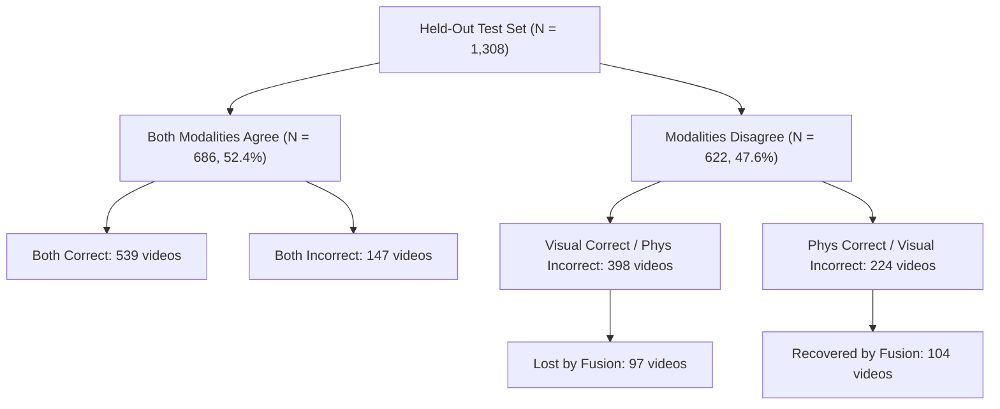

# BIOTrace Experimental Results, Analysis & Scientific Limitations

This document presents the empirical benchmark results of BIOTrace on the frozen **Protocol C** held-out test dataset ($N = 1,308$ videos), followed by statistical significance testing, error analysis, and methodological limitations.

---

## 1. Held-Out Benchmark Performance

All models were evaluated under identical conditions on the **Protocol C** held-out test partition (654 authentic videos, 654 manipulated videos; zero actor overlap with training or validation splits).

### Comparative Performance Table
| Model | Operating Threshold ($\theta$) | ROC-AUC (95% CI) | PR-AUC | Accuracy (%) | Precision | Recall | F1 Score | Equal Error Rate (EER) | Brier Score |
| :--- | :---: | :---: | :---: | :---: | :---: | :---: | :---: | :---: | :---: |
| **Visual Baseline** *(Phase 6 EfficientNet-B0)* | $0.5343^*$ $0.5000$ | $0.7821$ $(0.7571, 0.8054)$ | $0.7550$ | $71.64\%$ $72.25\%$ | $0.7180$ $0.6969$ | $0.7125$ $0.7875$ | $0.7153$ $0.7394$ | $28.13\%$ | $0.1991$ |
| **Physiological Baseline** *(Phase 9 Random Forest)* | $0.5128^*$ $0.5000$ | $0.6267$ $(0.5975, 0.6581)$ | $0.6117$ | $58.33\%$ $57.95\%$ | $0.5832$ $0.5737$ | $0.5841$ $0.6193$ | $0.5837$ $0.5956$ | $41.67\%$ | $0.2380$ |
| **Multimodal Fusion** *(Phase 10 Logistic Regression)* | $\mathbf{0.4999^*}$ $0.5000$ | $\mathbf{0.7952}$ $\mathbf{(0.7713, 0.8188)}$ | $\mathbf{0.7799}$ | $\mathbf{72.17\%}$ $72.09\%$ | $\mathbf{0.7224}$ $0.7220$ | $\mathbf{0.7202}$ $0.7187$ | $\mathbf{0.7213}$ $0.7203$ | $\mathbf{27.83\%}$ | $\mathbf{0.1866}$ |

$^*$ *Threshold optimized strictly on the validation partition.*

---

## 2. Multimodal Fusion Evaluation & Statistical Significance

### 2.1 Metric Deltas Over Visual Baseline
Combining the visual convolutional representations with the 10-feature physiological/kinematic vector yields the following empirical improvements:
- **$\Delta$ ROC-AUC**: $+0.0132$ ($+1.32$ percentage points)
- **$\Delta$ PR-AUC**: $+0.0249$ ($+2.49$ percentage points)
- **$\Delta$ Accuracy**: $+0.0054$ ($+0.54$ percentage points at optimal threshold)
- **$\Delta$ F1 Score**: $+0.0060$ ($+0.60$ percentage points)
- **$\Delta$ Brier Score**: $-0.0125$ (calibration error reduction of $6.28\%$)
- **$\Delta$ EER**: $-0.30$ percentage points (reduced from $28.13\%$ to $27.83\%$)

### 2.2 Bootstrap Significance Analysis (10,000 Resamples)
To assess whether the $+0.0132$ ROC-AUC gain represents genuine generalizable signal or random sampling variation, a non-parametric bootstrap test ($B = 10,000$) was conducted over the test set:
- **Mean $\Delta$ ROC-AUC**: $+0.0132$
- **95% Bootstrap Confidence Interval**: $[-0.0007, +0.0274]$
- **Empirical Probability $P(\Delta \text{ROC-AUC} > 0)$**: $96.9\%$ ($p = 0.031$ one-tailed)

> [!IMPORTANT]
> **Scientific Interpretation**:
> The 95% two-tailed confidence interval slightly crosses zero ($[-0.0007, +0.0274]$). While the multimodal fusion model outperforms the visual baseline in **96.9%** of bootstrap trials, the improvement is **modest and not statistically decisive at a strict two-tailed $\alpha = 0.05$ significance level**.
> We therefore report that physiological signals provide a modest, promising complementary signal rather than a revolutionary breakthrough.

---

## 3. Case Interaction & Error Breakdown

To understand how the modalities interact, we analyzed individual test video predictions ($N = 1,308$):

### Key Error Observations:
1. **Complementary Recovery**: In 224 instances where the visual baseline failed, the physiological model was correct. The multimodal fusion model successfully recovered **104 of these visual failure cases**.
2. **Harmful Overruling**: In 398 instances where the visual baseline was correct but physiology failed, the fusion model incorrectly overruled the visual prediction in **97 cases**.
3. **Net Benefit**: The net gain is $+7$ correctly classified videos ($104 - 97 = +7$), confirming a modest net positive synergy.

---

## 4. Threats to Validity & Scientific Limitations

### 4.1 Short Video Duration & Rayleigh Frequency Limit
The HiDF video clips average **~2.96 seconds** (approximately 74–90 frames at 25–30 FPS).
- The fundamental frequency resolution for Fourier or spectral peak estimation is bounded by:
  $$\Delta f = \frac{1}{T} \approx \frac{1}{2.96\,\text{s}} \approx 0.338\,\text{Hz} \approx 20.3\,\text{BPM}$$
- Consequently, true physiological pulse estimation within a 2.96-second window possesses an intrinsic uncertainty of $\pm 20.3$ BPM.
- Extracted rPPG features (`rppg_pos_snr_db`, `rppg_pos_chrom_corr`) measure **short-window chromatic consistency** rather than sustained cardiac rhythms.

### 4.2 Facial Kinematics Dynamic Range
Natural human blink rates range between 12 and 18 blinks per minute (one blink every 3.3 to 5.0 seconds). In a 2.96-second video:
- A significant proportion of authentic subjects perform zero full blinks.
- Discrete metrics (blink count, blink duration) are degenerate and unreliable.
- Continuous kinematic measures (`ear_velocity_mean`, `ear_opening_vel_max`, `ear_right_std`) are robust to non-blinking frames but remain sensitive to subtle micro-expressions and camera motion.

### 4.3 Generalization Across Compression & Datasets
- Evaluations were conducted strictly on the HiDF Protocol C benchmark.
- Heavy lossy re-encoding (e.g., WhatsApp, Twitter/X, H.264 CRF > 28) is known to attenuate high-frequency chromatic variations required for rPPG.
- Cross-dataset evaluation on uncompressed or differently compressed datasets (e.g., FaceForensics++, Celeb-DF) is required before deploying in unconstrained wild environments.

### 4.4 Uncalibrated Heuristic Disclaimer
- All outputs produced by BIOTrace represent empirical anomaly scores for research analysis.
- They **do not constitute certified forensic proof** for judicial proceedings.
