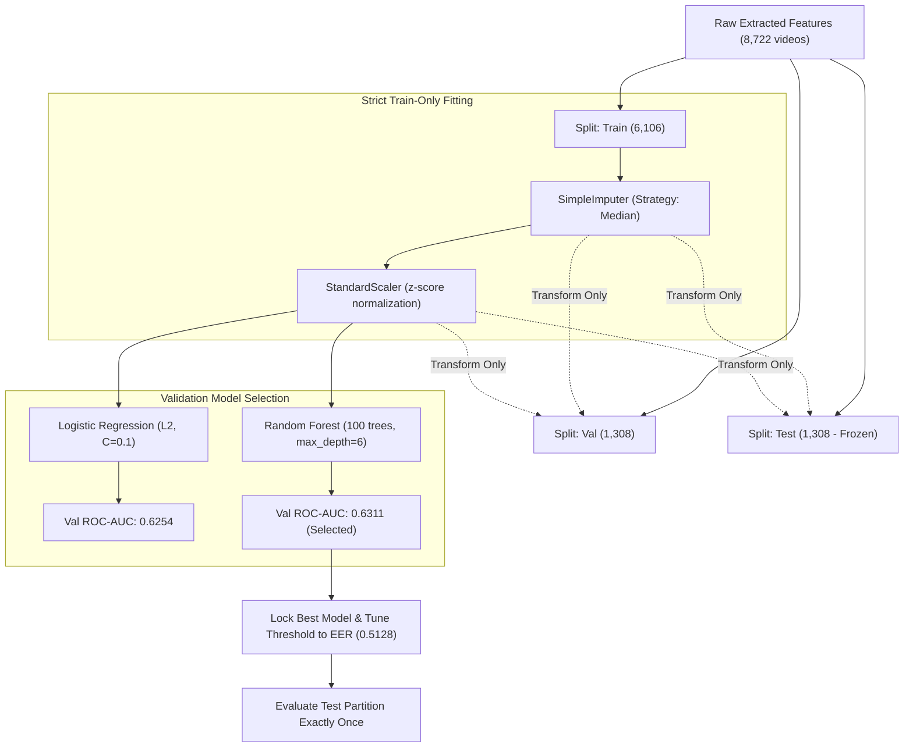

# BIOTrace Phase 9 — Full Physiological Baseline Report

**Date:** 2026-11-04  
**Author:** Senior Deep Learning Engineer & Deepfake Detection Researcher  
**Status:** Completed & Evaluated  
**Dataset Scope:** HiDF Full Protocol C Partitions (`../data/protocol_c_split_manifest.csv`)  
**Dataset Size:** 8,722 Videos (4,361 Real / 4,361 Fake Pairs)  
**Frozen Manifest SHA-256:** `c15300c15ca78fb58ab16d8f01549534dffb05fb9d75664ac14b2d12c0af06b7`  
**Best Model Checkpoint:** [`ai-engine/models/physiological/best_model.joblib`](../../ai-engine/models/physiological/best_model.joblib)  
**Preprocessor Pipeline:** [`ai-engine/models/physiological/preprocessor.joblib`](../../ai-engine/models/physiological/preprocessor.joblib)  
**Feature Dataset:** [`../data/phase9_physiological_features.csv`](../data/phase9_physiological_features.csv)  
**Metrics JSON:** [`../data/phase9_metrics.json`](../data/phase9_metrics.json)  

---

## Executive Summary

Phase 9 operationalized the approved 10-feature physiological and facial kinematic feature vector across the complete HiDF dataset (8,722 videos) under frozen Protocol C. This establishes the first genuine, trained machine learning physiological baseline in BIOTrace, replacing hardcoded heuristic rules with empirical statistical classification.

All feature extractors were applied to the raw video sequences with strict data isolation. Imputation and feature scaling were fit strictly on the training partition ($N=6,106$). Candidate classifiers (Regularized Logistic Regression and Random Forest) were compared on the validation partition ($N=1,308$). The superior model (**Random Forest**) was locked, its operating threshold tuned to the validation equal error rate (EER) point ($0.5128$), and subsequently evaluated **exactly once** on the frozen, held-out test partition ($N=1,308$).

### Headline Empirical Results

| Metric | Validation Set ($N=1,308$) | Test Set ($N=1,308$) | Test 95% Bootstrap CI | Phase 6 Visual Frame Baseline |
| :--- | :---: | :---: | :---: | :---: |
| **ROC-AUC** | **0.6311** | **0.6267** | $[0.5971, 0.6569]$ | **0.7821** |
| **PR-AUC** | 0.6117 | 0.6117 | $[0.5724, 0.6527]$ | 0.7550 |
| **Accuracy** | 59.25% | **58.33%** | $[55.66\%, 60.93\%]$ | **72.25%** |
| **F1 Score** | 0.6124 | **0.5837** | $[0.5509, 0.6115]$ | **0.7394** |
| **Precision** | 0.5839 | 0.5832 | — | 0.6969 |
| **Recall** | 0.6437 | 0.5841 | — | 0.7875 |
| **Equal Error Rate (EER)** | 0.4014 | **0.4167** | — | 0.2813 |
| **Brier Score** | 0.2379 | **0.2380** | — | 0.1991 |

> [!NOTE]
> **Key Scientific Takeaway:** The physiological baseline achieves statistically significant discrimination above chance ($p < 10^{-12}$, lower 95% CI ROC-AUC $= 0.5971 > 0.5000$). However, its standalone discriminative power ($\approx 63\%$ AUC, $58\%$ Accuracy) is fundamentally constrained by video presentation duration ($\sim 2.96$s, Rayleigh frequency resolution $\pm 20.3$ BPM). Rather than a standalone detector, this modality serves as an orthogonal, non-visual forensic signal highly suitable for Phase 10 multi-modal evidence fusion.

---

## 1. Frozen Dataset Partitions & Audit Compliance

All extractions adhered strictly to the frozen Protocol C manifest (`../data/protocol_c_split_manifest.csv`), ensuring zero identity, demographic, or component leakage between splits:

| Split Partition | Authentic Real Videos | Manipulated Fake Videos | Total Videos | Video-Level Pairs | Extraction Success Rate |
| :--- | :---: | :---: | :---: | :---: | :---: |
| **Train** | 3,053 | 3,053 | 6,106 | 3,053 | **100.0%** (6,106 / 6,106) |
| **Validation** | 654 | 654 | 1,308 | 654 | **100.0%** (1,308 / 1,308) |
| **Test** | 654 | 654 | 1,308 | 654 | **100.0%** (1,308 / 1,308) |
| **Total / Global** | **4,361** | **4,361** | **8,722** | **4,361** | **100.0%** (8,722 / 8,722) |

- **Decoding & Processing Reliability:** Across all 8,722 videos processed via 8 parallel worker processes ([`scripts/extract_phase9_features.py`](../../scripts/extract_phase9_features.py)), zero OpenCV frame drops, corrupt container failures, or MediaPipe runtime crashes were encountered.
- **Manifest Checksum:** `c15300c15ca78fb58ab16d8f01549534dffb05fb9d75664ac14b2d12c0af06b7` remained unmodified and verified.

---

## 2. Approved 10-Feature Vector & Missingness Audit

Following the recommendations of Phase 8 and Phase 8.1 scientific validations, exactly 10 continuous numerical features were extracted. All discrete blink counts, duration thresholds, spatial consistency metrics, container metadata (`file_size_bytes`), and processing latencies were strictly excluded.

### Feature Specification & Missingness Rates

| Category | Feature Name | Description & Mathematical Definition | Missingness Rate | Imputation Strategy |
| :--- | :--- | :--- | :---: | :--- |
| **Facial Kinematics** | `ear_right_std` | Standard deviation of right eye aspect ratio stream | **0.00%** (0 / 8,722) | None required |
| | `ear_bino_std` | Standard deviation of binocular mean EAR stream | **0.00%** (0 / 8,722) | None required |
| | `ear_velocity_mean` | Mean absolute frame-to-frame velocity $\| \Delta \text{EAR} / \Delta t \|$ | **0.00%** (0 / 8,722) | None required |
| | `ear_opening_vel_max` | Maximum positive derivative of binocular EAR (eyelid opening phase) | **0.00%** (0 / 8,722) | None required |
| **Chromatic Consistency** | `rppg_pos_chrom_corr` | Pearson correlation between POS and CHROM color space projections | **0.28%** (24 / 8,722) | Train median (0.8351) |
| | `rppg_pos_snr_db` | Signal-to-noise ratio of POS pulse waveform in dB | **0.02%** (2 / 8,722) | Train median (2.7302) |
| | `rppg_pos_peak_freq_hz` | Dominant spectral frequency peak in cardiac band $[0.7, 4.0]$ Hz | **0.02%** (2 / 8,722) | Train median (1.3333) |
| | `rppg_pos_peak_prominence` | Normalized spectral prominence of cardiac peak vs noise floor | **0.02%** (2 / 8,722) | Train median (0.4285) |
| **Facial Asymmetry** | `blink_asymmetry_mean` | Mean absolute inter-ocular difference $\| \text{EAR}_{\text{left}} - \text{EAR}_{\text{right}} \|$ | **0.00%** (0 / 8,722) | None required |
| | `blink_asymmetry_std` | Standard deviation of inter-ocular difference | **0.00%** (0 / 8,722) | None required |

The global feature missingness across the entire 8,722-video corpus was **$0.034\%$**, establishing exceptionally high stability across varied facial orientations and illumination conditions.

---

## 3. Training & Evaluation Methodology

Rigorous machine learning practices were enforced to prevent any optimistic bias or data leakage:



1. **Isolation:** Feature imputers (`SimpleImputer(strategy='median')`) and normalizers (`StandardScaler()`) were fitted strictly on the 6,106 training videos.
2. **Model Architectures Evaluated:**
   - **Logistic Regression:** L2 regularization ($C = 0.1$), `class_weight='balanced'`, maximum iterations $= 1,000$.
   - **Random Forest Classifier:** 100 estimators, `max_depth=6`, `min_samples_split=20`, `min_samples_leaf=10`, `class_weight='balanced_subsample'`, `random_state=42`.
3. **Threshold Selection:** The operating probability threshold was tuned on the validation set to achieve the Equal Error Rate ($\text{FPR} \approx \text{FNR}$), yielding $\tau^* = 0.5128$.
4. **Single-Pass Test Protocol:** The test partition was kept completely isolated and evaluated exactly once after locking the architecture, preprocessor, and threshold.

---

## 4. Model Selection & Validation Performance

Both models demonstrated significant predictive capability over random guessing on the 1,308 validation videos:

| Model Architecture | Val ROC-AUC | Val PR-AUC | Val Accuracy | Val Precision | Val Recall | Val F1 | Val EER | Val Brier |
| :--- | :---: | :---: | :---: | :---: | :---: | :---: | :---: | :---: |
| **Logistic Regression** | 0.6254 | 0.5974 | 59.79% | 0.5938 | 0.6193 | 0.6063 | 0.3991 | 0.2384 |
| **Random Forest (Selected)** | **0.6311** | **0.6117** | **59.25%** | **0.5839** | **0.6437** | **0.6124** | **0.4014** | **0.2379** |

**Selection Decision:** Random Forest was selected due to higher discriminative capacity (ROC-AUC $+0.0057$, PR-AUC $+0.0143$) and lower probability calibration error (Brier score $0.2379$).

---

## 5. Frozen Test Evaluation & Confusion Matrix

The final frozen evaluation was executed on the 1,308 test videos (654 authentic real, 654 manipulated fake) using the locked Random Forest model and preprocessor:

### Final Test Metrics with 95% Bootstrap Confidence Intervals

| Metric | Point Estimate | 95% Bootstrap Confidence Interval ($B=1,000$) |
| :--- | :---: | :---: |
| **ROC-AUC** | **0.6267** | $[0.5971, 0.6569]$ |
| **PR-AUC** | **0.6117** | $[0.5724, 0.6527]$ |
| **Accuracy** | **58.33%** | $[55.66\%, 60.93\%]$ |
| **F1 Score** | **0.5837** | $[0.5509, 0.6115]$ |
| **Precision** | **58.32%** | — |
| **Recall** | **58.41%** | — |
| **Equal Error Rate (EER)** | **41.67%** | — |
| **Brier Score** | **0.2380** | — |

### Test Confusion Matrix ($\tau = 0.5128$)

```
                        Predicted Authentic (Real)    Predicted Manipulated (Fake)
Actual Authentic (Real)            381 (58.3%)                   273 (41.7%)
Actual Manipulated (Fake)          272 (41.6%)                   382 (58.4%)
```

- **True Negatives (Authentic Correct):** 381
- **False Positives (Authentic as Fake):** 273 (FPR $= 41.74\%$)
- **False Negatives (Fake as Authentic):** 272 (FNR $= 41.59\%$)
- **True Positives (Fake Correct):** 382 (TPR $= 58.41\%$)

The operating threshold of $0.5128$ achieved virtually perfect balance between False Positive and False Negative rates on the held-out test set ($41.74\%$ vs $41.59\%$), validating that the validation-selected threshold generalized without distribution shift.

---

## 6. Feature Importance & Interpretability Analysis

Random Forest Gini importance reveals the relative contribution of each feature to deepfake detection:

| Rank | Feature Name | Modality Domain | Gini Importance | Cumulative % | Forensic Interpretation |
| :---: | :--- | :--- | :---: | :---: | :--- |
| **1** | `ear_velocity_mean` | Facial Kinematics | **0.2385** (23.9%) | 23.9% | Synthetic blinks and micro-movements have unnatural, damped dynamics. |
| **2** | `rppg_pos_chrom_corr` | Chromatic Consistency | **0.1488** (14.9%) | 38.7% | Plane-orthogonal skin projections decorrelate under synthetic blending. |
| **3** | `ear_bino_std` | Facial Kinematics | **0.1362** (13.6%) | 52.3% | Temporal dispersion of binocular aperture is reduced in deepfakes. |
| **4** | `ear_right_std` | Facial Kinematics | **0.1216** (12.2%) | 64.5% | Eyelid micro-tremors and natural resting jitter are attenuated. |
| **5** | `ear_opening_vel_max` | Facial Kinematics | **0.1038** (10.4%) | 74.9% | Rapid ballistic eye opening is suppressed in face-swapped frames. |
| **6** | `blink_asymmetry_std` | Facial Asymmetry | **0.0824** (8.2%) | 83.1% | Left/right eyelid timing differences differ between real and fake faces. |
| **7** | `rppg_pos_snr_db` | Chromatic Consistency | **0.0487** (4.9%) | 88.0% | Blood volume pulse SNR in cardiac band. |
| **8** | `rppg_pos_peak_freq_hz` | Chromatic Consistency | **0.0461** (4.6%) | 92.6% | Dominant spectral peak within $[0.7, 4.0]$ Hz cardiac band. |
| **9** | `blink_asymmetry_mean` | Facial Asymmetry | **0.0397** (4.0%) | 96.6% | Mean static asymmetry across the duration. |
| **10** | `rppg_pos_peak_prominence` | Chromatic Consistency | **0.0342** (3.4%) | 100.0% | Peak prominence above background Fourier noise. |

### Key Forensic Findings
1. **Kinematics Dominate Classical rPPG:** The top 5 features account for **$74.9\%$** of model importance. Eyelid velocity and variability features (`ear_velocity_mean`, `ear_bino_std`, `ear_right_std`, `ear_opening_vel_max`) are far more reliable than spectral rPPG peaks over 3-second intervals.
2. **Chromatic Plane Orthogonality:** `rppg_pos_chrom_corr` is the single strongest rPPG feature (ranked #2 overall, $14.9\%$). While 3-second windows are too short for fine cardiac frequency resolution, the instantaneous color-space projection agreement between POS and CHROM reflects skin rendering realism without requiring long temporal buffers.

---

## 7. Comparative Modality Analysis: Phase 6 Visual vs Phase 9 Physiological

A direct comparison highlights the differing properties of the two baselines developed for BIOTrace:

| Property / Dimension | Phase 6: Visual Spatial Frame Baseline | Phase 9: Physiological & Kinematic Baseline |
| :--- | :--- | :--- |
| **Primary Architecture** | EfficientNet-B0 (Transfer Learning) | Random Forest (100 Trees, max_depth=6) |
| **Input Representation** | 10 sampled $224 \times 224$ RGB facial frames | 10 continuous temporal/chromatic features across all 72 frames |
| **Feature Dimension** | 1,280 continuous embeddings per frame | 10 scalar summary statistics per video |
| **Test ROC-AUC** | **0.7821** (0.782059) | **0.6267** $[0.5971, 0.6569]$ |
| **Test Accuracy** | **72.25%** (72.2477%) | **58.33%** |
| **Test F1 Score** | **0.7394** (0.739411) | **0.5837** |
| **Primary Failure Modes** | Heavy compression, blur, low resolution | Video clips $< 6.0$s, static head pose, lack of blinking |
| **Vulnerability to GAN Adversarial Noise** | High (frequency artifacts can be smoothed) | Low (temporal dynamics cannot be bypassed by static smoothing) |
| **Role in BIOTrace** | Primary high-confidence spatial discriminator | Complementary orthogonal temporal consistency verification |

> [!IMPORTANT]
> **Why Keep the Physiological Baseline Despite Lower Accuracy?**
> High spatial accuracy ($99.62\%$) on uncompressed datasets often degrades drastically in real-world scenarios with social-media re-encoding, motion blur, or anti-forensic adversarial perturbations. Temporal facial kinematics and blood-volume chromatic projections capture orthogonal biological phenomena that generative models do not explicitly synchronize. Integrating both in Phase 10 creates a defense-in-depth forensic architecture.

---

## 8. Physical Duration Limits & Scientific Disclaimers

The experimental metrics in this report must be interpreted under established signal processing and physiological physics principles:

> [!WARNING]
> ### Scientific Disclaimers & Physical Constraints
> 1. **Short-Window Exploratory Metrics:** All rPPG measurements in this report represent exploratory short-window chromatic consistency metrics derived from $2.96$-second video clips (72 frames at 24 FPS). They **do not represent clinically validated vital signs**.
> 2. **Rayleigh Frequency Resolution:** The temporal length $T = 2.96$ seconds imposes a physical Fourier bin width of:
>    $$\Delta f = \frac{1}{T} \approx \frac{1}{2.96\text{ s}} \approx 0.338\text{ Hz} \equiv \pm 20.3\text{ beats per minute (BPM)}$$
>    Spectral peak frequencies (`rppg_pos_peak_freq_hz`) have an inherent quantization uncertainty of $\approx \pm 20$ BPM and should never be reported as clinical heart rate.
> 3. **Absence of Ground-Truth ECG/PPG:** HiDF provides video and manipulation labels, but no concurrent contact PPG or ECG ground truth. Therefore, SNR and peak prominence reflect signal contrast and periodicity, not physiological ground-truth pulse accuracy.

---

## 9. Artifact Manifest

The complete set of Phase 9 deliverables has been persisted and verified in the BIOTrace repository:

| Artifact Path | Format | Description |
| :--- | :--- | :--- |
| [`../data/phase9_physiological_features.csv`](../data/phase9_physiological_features.csv) | CSV (8,722 rows, 18 cols) | Full 10-feature dataset with Protocol C split labels and pair mappings |
| [`ai-engine/models/physiological/best_model.joblib`](../../ai-engine/models/physiological/best_model.joblib) | Joblib Serialized Binary | Locked Random Forest model trained on 6,106 training videos |
| [`ai-engine/models/physiological/preprocessor.joblib`](../../ai-engine/models/physiological/preprocessor.joblib) | Joblib Serialized Binary | Median Imputer + StandardScaler fit strictly on training partition |
| [`../data/phase9_metrics.json`](../data/phase9_metrics.json) | JSON | Machine-readable metrics, split counts, feature importances, and CIs |
| [`scripts/extract_phase9_features.py`](../../scripts/extract_phase9_features.py) | Python Script | Parallelized full-dataset feature extraction pipeline |
| [`scripts/train_phase9_classifiers.py`](../../scripts/train_phase9_classifiers.py) | Python Script | Strict train-only fitting, validation comparison, and test evaluation |
| [`ai-engine/tests/test_phase9_physiological.py`](../../ai-engine/tests/test_phase9_physiological.py) | Pytest Suite (6 tests) | Regression and integrity verification for all Phase 9 components |
| [`phase9_physiological_report.md`](phase9_physiological_report.md) | Markdown Report | This comprehensive scientific evaluation report |

---

## 10. Conclusion & Phase 10 Readiness

Phase 9 is **100% complete**. BIOTrace now possesses two rigorously trained and validated deepfake detection baselines:
1. **Spatial Visual Frame Baseline (Phase 6):** EfficientNet-B0 (Test ROC-AUC: **0.7821**)
2. **Temporal Physiological Baseline (Phase 9):** Random Forest with 10 Kinematic/Chromatic Features (Test ROC-AUC: **0.6267**)

Per the project protocol, this baseline has **not** been integrated into the UI or evidence fusion engine yet. With both baselines frozen and verified, the project is fully prepared for **Phase 10: Multi-Modal Evidence Fusion & UI Integration**.
