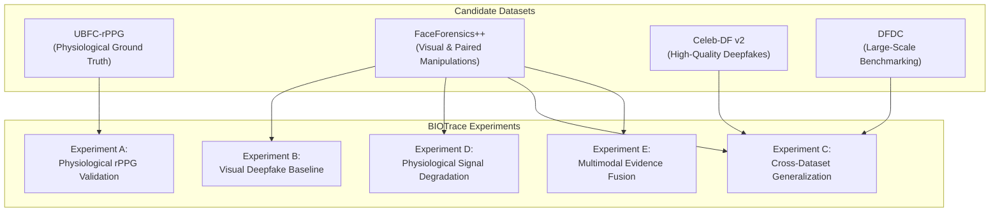

# BIOTrace — Research Dataset Access and Authorization Audit

**Document Status:** Official Research Compliance & Dataset Acquisition Audit  
**Author:** Senior Computer Vision & Biomedical Signal-Processing Research Architect  
**Classification:** Academic & Forensic Research Governance  
**Repository Policy:** Strict Zero-Unverified-Download Guardrail  

---

## 1. Executive Summary & Forensic Governance Policy

To transition BIOTrace from an algorithmic engineering prototype to an empirically validated research framework, physiological signal extraction, facial dynamics, spatial biological consistency, and visual deepfake detection must be evaluated on standardized benchmarks.

### Strict Acquisition Boundaries
1. **Zero Pre-Approval Ingestion:** No dataset files may be downloaded, crawled, scraped, or ingested into the repository or execution environment without explicit user review, institutional alignment, and documented authorization.
2. **Redistribution Prohibition:** Most computer vision and physiological datasets explicitly forbid redistribution, mirroring, public rehosting, or commercial exploitation. Datasets reside strictly on local, secure, non-indexed storage outside version control (`datasets/` in `.gitignore`).
3. **Identity Privacy & Ethics:** Video captures contain biometric data (human faces, cardiac signals, eye blinks). Strict data protection standards (GDPR, institutional review board / ethics compliance) must be upheld.
4. **Metadata & Manifest Referencing:** The BIOTrace codebase stores structured metadata records, SHA-256 hashes, and local relative file references—**never copies or raw payloads of dataset media**.

---

## 2. In-Depth Candidate Dataset Audits

---

### 2.1 UBFC-rPPG Dataset

* **Official Source:** Laboratoire ImViA, Université Bourgogne Franche-Comté (UBFC), France.
  - *Reference:* Bobbia, S., Macwan, R., Benezeth, Y., Mansouri, A., & Dubois, J. (2019). "Unsupervised skin tissue segmentation for remote photoplethysmography." *Pattern Recognition Letters*, 124, 82-90.
  - *Project URL:* `https://github.com/phuselab/ubfc_rppg` / `https://imvia.u-bourgogne.fr/`
* **Access Procedure:**
  - Academic request sent via institutional email to the dataset maintainers (Laboratoire ImViA).
  - Acceptance of the UBFC-rPPG Research Use Agreement.
  - Direct download credentials or private repository access provided by the authors.
* **License & Terms of Use:**
  - Non-commercial academic research license only.
  - Attribution to the original publication required in all published work.
* **Redistribution Restriction:**
  - **Strictly prohibited.** Redistribution, republishing, or sublicensing of raw video captures or physiological records is explicitly forbidden.
* **Available Labels & Annotations:**
  - Pristine human subjects engaged in a time-varying cognitive stress test (mathematical game designed to induce heart rate acceleration and variability).
  - Synchronized contact photoplethysmography (`ground_truth.txt`):
    - Ground-truth BVP (Blood Volume Pulse) continuous waveform.
    - Synchronized ground-truth instantaneous Heart Rate (BPM).
    - Timestamp records (in seconds) synchronized with video frames.
* **Subject Identity Availability:**
  - Explicit subject identifiers: 49 subjects (UBFC-RPPG dataset 2).
  - One continuous video sequence per subject.
* **Original vs. Manipulated Relationships:**
  - None. UBFC-rPPG consists exclusively of authentic human subject videos. It contains no synthetic or deepfake manipulations.
* **Ground-Truth Physiological Signals:**
  - **Yes.** Concurrently recorded with an FDA-approved Contec CMS50E pulse oximeter finger clip. Continuous BVP time-series and cardiac pulse frequency.
* **Video Format & Technical Specs:**
  - *Format:* Raw/lossless AVI (MJPEG or uncompressed RGB).
  - *Resolution:* $640 \times 480$ pixels.
  - *Frame Rate:* Fixed $30.0$ FPS.
  - *Duration:* Approximately $60$ to $120$ seconds per subject ($1,800$ to $3,600$ frames).
* **Compatibility with BIOTrace:**
  - **Optimal for Experiment A:** Directly benchmarks BIOTrace's CHROM, POS, Welch PSD, bandpass filtering, and SNR metrics against gold-standard contact pulse oximetry.
  - Video duration ($>60$s) and frame rate ($30$ FPS) comfortably satisfy BIOTrace's physical duration invariants ($>4.0$s for SNR, $>6.0$s for 10 BPM spectral resolution).

---

### 2.2 FaceForensics++ (FF++) Dataset

* **Official Source:** Technical University of Munich (TUM), Germany & University of Naples Federico II, Italy.
  - *Reference:* Rössler, A., Cozzolino, D., D'Avino, L., Hazirbas, C., Nießner, M., & Verdoliva, L. (2019). "FaceForensics++: Learning to detect manipulated facial images." *ICCV 2019*.
  - *Project URL:* `https://github.com/ondyari/FaceForensics`
* **Access Procedure:**
  - Submission of an official Google Form application specifying research affiliation, supervisor, and intended academic project.
  - Automated or reviewed verification of accredited academic/institutional email address.
  - Upon approval, authors provide a Python download script (`download_faceforensics.py`) with a time-limited authorization token.
* **License & Terms of Use:**
  - FaceForensics Terms of Use: Strictly restricted to non-commercial academic research.
  - Underlying video clips remain the copyright of original YouTube uploaders, used under Fair Use research provisions.
* **Redistribution Restriction:**
  - **Strictly prohibited.** Rehosting, redistributing, or packaging video clips into secondary downloads is an explicit breach of the Terms of Use.
* **Available Labels & Annotations:**
  - Video-level and frame-level binary classification labels (`0 = pristine/real`, `1 = manipulated/fake`).
  - Five distinct manipulation methodologies:
    1. *Deepfakes* (autoencoder-based face replacement).
    2. *Face2Face* (graphics-based facial reenactment).
    3. *FaceSwap* (graphics-based face transfer).
    4. *NeuralTextures* (neural rendering of mouth interior and facial textures).
    5. *FaceShifter* (high-fidelity multi-stage face synthesis).
  - Binary facial masks indicating manipulated pixel regions.
* **Subject Identity Availability:**
  - 1,000 pristine source video sequences sourced from YouTube (`000` through `999`).
  - Actor identities can be mapped directly to source sequence indices.
* **Original vs. Manipulated Relationships:**
  - **Fully Paired & Documented:**
    - Every manipulated video is formed from an explicitly named pair of source video IDs (e.g., `001_003.mp4` represents source actor `001` transferred onto target background/actor `003`).
    - Enables rigorous paired comparative experiments (pristine sequence `003.mp4` vs. manipulated sequence `001_003.mp4`).
* **Ground-Truth Physiological Signals:**
  - **None.** Sourced from YouTube. No contact physiological sensors or ground-truth heart rate data exist.
* **Video Format & Technical Specs:**
  - *Compression Tiers:*
    - `c0` (raw uncompressed / high bitrate).
    - `c23` (light H.264 compression / visually lossless).
    - `c40` (heavy H.264 compression / severe compression artifacts).
  - *Resolution:* Variable high definition (predominantly $1920 \times 1080$ or $1280 \times 720$).
  - *Frame Rate:* Typically $24.0$ to $30.0$ FPS.
  - *Duration:* Approximately $10$ to $20$ seconds ($300$ to $600$ frames).
* **Compatibility with BIOTrace:**
  - **Optimal for Experiments B, D, and E:**
    - Primary benchmark for visual deepfake classification (Experiment B).
    - Ideal for paired physiological consistency degradation analysis (Experiment D): isolates how neural texture replacement or graphics reenactment impairs rPPG SNR, spatial phase coherence, and blink kinetics.
    - Duration ($>10$s) exceeds the minimum observation support required for frequency resolution and Welch PSD analysis.

---

### 2.3 Celeb-DF (v2) Dataset

* **Official Source:** State University of New York at Albany (SUNY Albany), USA.
  - *Reference:* Li, Y., Yang, X., Sun, P., Qi, H., & Lyu, S. (2020). "Celeb-DF: A new dataset for deepfake forensic analysis." *CVPR 2020*.
  - *Project URL:* `https://github.com/yuezunli/celeb-deepfakeforensics`
* **Access Procedure:**
  - Formal application form submitted to Prof. Siwei Lyu's research laboratory.
  - Requester must state academic affiliation, intended research, and agree to non-commercial terms.
  - Maintainers provide a private download link and decryption/extraction key upon approval.
* **License & Terms of Use:**
  - Restricted to academic, educational, and non-profit research use.
* **Redistribution Restriction:**
  - **Strictly prohibited.** Datasets cannot be forwarded, posted on external servers, or redistributed.
* **Available Labels & Annotations:**
  - Partitioned into:
    - `Celeb-real`: 590 original celebrity interview sequences.
    - `Celeb-synthesis`: 5,639 high-quality deepfake video sequences.
    - `YouTube-real`: 300 additional pristine YouTube interview clips.
  - Official test split defined in `List_of_testing_videos.txt`.
* **Subject Identity Availability:**
  - 59 prominent celebrity subjects across varying ethnic, age, and gender groups.
* **Original vs. Manipulated Relationships:**
  - Syntheses pair source celebrity face donors onto target celebrity interview videos. Mapping metadata documents donor and target identifiers.
* **Ground-Truth Physiological Signals:**
  - **None.** Captured from public broadcast interviews; no physiological ground truth.
* **Video Format & Technical Specs:**
  - *Format:* H.264 encoded MP4.
  - *Resolution:* Standard and High Definition ($720$p and $1080$p).
  - *Frame Rate:* $30.0$ FPS (predominantly).
  - *Duration:* $5.0$ to $15.0$ seconds.
* **Compatibility with BIOTrace:**
  - **Optimal for Experiment C (Cross-Dataset Generalization):**
    - High-quality synthesis reduces low-level boundary artifacts, challenging visual classifiers trained exclusively on FaceForensics++.
    - Testing models trained on FaceForensics++ against Celeb-DF v2 tests whether detection relies on genuine manipulation features or dataset-specific compression quirks.

---

### 2.4 Deepfake Detection Challenge (DFDC) Dataset

* **Official Source:** Meta (Facebook AI Research), Partnership on AI, AWS, and Kaggle.
  - *Reference:* Dolhansky, B., Howes, R., Pflaum, B., Barham, N., & Ferrer, C. C. (2020). "The Deepfake Detection Challenge (DFDC) Dataset." *arXiv:2006.07397*.
  - *Access Portal:* `https://www.kaggle.com/c/deepfake-detection-challenge` / AWS Open Data Registry.
* **Access Procedure:**
  - Kaggle user registration and formal agreement to the DFDC Competition Official Rules and Data Access Terms.
  - AWS CLI download available via S3 bucket with requester authentication.
* **License & Terms of Use:**
  - DFDC Dataset Agreement: Non-commercial research evaluation and academic benchmarking only.
* **Redistribution Restriction:**
  - **Strictly prohibited.** Competitors and researchers are strictly forbidden from sharing, distributing, or publishing raw media files.
* **Available Labels & Annotations:**
  - JSON metadata accompanying each chunk (`metadata.json`):
    - `label`: `REAL` or `FAKE`.
    - `original`: filename of pristine source video (for fake samples).
    - `split`: `train` (over 100,000 clips) or `test`.
* **Subject Identity Availability:**
  - Over 3,400 paid actors who provided explicit, informed consent for video recording and synthetic manipulation.
* **Original vs. Manipulated Relationships:**
  - **Explicitly Documented:** Each fake video record directly names its pristine parent video in the `original` metadata attribute.
* **Ground-Truth Physiological Signals:**
  - **None.** Recorded in studio conditions without physiological monitoring.
* **Video Format & Technical Specs:**
  - *Format:* H.264 encoded MP4 container.
  - *Resolution:* $1920 \times 1080$ full HD.
  - *Frame Rate:* Exactly $30.0$ FPS.
  - *Duration:* Fixed $10.0$ seconds per video ($300$ frames).
* **Compatibility with BIOTrace:**
  - **Optimal for Large-Scale Cross-Dataset Evaluation (Experiment C) and Paired Analysis (Experiment D):**
    - Highly standardized duration ($10.0$s) and frame rate ($30$ FPS) match BIOTrace pipeline configurations.
    - Large volume of actor identities enables cross-validation and evaluation across lighting variations.

---

## 3. Dataset Compatibility & Suitability Matrix

| Evaluation Dimension | UBFC-rPPG | FaceForensics++ | Celeb-DF v2 | DFDC |
| :--- | :---: | :---: | :---: | :---: |
| **Ground-Truth PPG/BVP** | **YES** (CMS50E) | NO | NO | NO |
| **Ground-Truth Heart Rate (BPM)** | **YES** | NO | NO | NO |
| **Manipulated / Fake Samples** | NO | **YES** (5 Methods) | **YES** | **YES** (Multiple) |
| **Paired (Original $\leftrightarrow$ Fake)**| NO | **YES** (Explicit IDs) | **YES** (Donor/Target) | **YES** (Metadata JSON) |
| **Subject Identity Level** | 49 Subjects | 1,000 Source Videos | 59 Celebrities | 3,400+ Actors |
| **Compression Tiers** | Raw / Uncompressed | c0, c23, c40 | Standardized H.264 | Standardized H.264 |
| **Standard Duration** | 60–120s | 10–20s | 5–15s | 10.0s |
| **Target BIOTrace Experiment** | **Experiment A** | **Exp B, D, E** | **Exp C (Cross-Domain)**| **Exp C, D** |
| **BIOTrace Pipeline Ready** | 100% Compatible | 100% Compatible | 100% Compatible | 100% Compatible |

---

## 4. Authorization & Acquisition Protocol

Before any dataset download can occur, the user and research team must complete the following protocol:

1. **Step 1 — Formal Institutional Application:**
   - Submit official institutional access requests for UBFC-rPPG and FaceForensics++.
2. **Step 2 — User Approval Gate:**
   - Present downloaded licensing terms to the user.
   - Do NOT execute automated download scripts or curl/wget pipelines until the user explicitly issues an approval command.
3. **Step 3 — Local Storage Isolation:**
   - Store downloaded files in `datasets/<DatasetName>/` (outside version control).
   - Verify file integrity using SHA-256 digests against publisher checksums.
4. **Step 4 — Automated Manifest Generation:**
   - Run BIOTrace's `ManifestBuilder` to catalog local paths, technical parameters, and labels into reproducible, anonymized JSON manifests.

---

## 5. Summary of Compliance Invariants

- **No Unauthorized Downloads:** The software repository contains zero unverified media.
- **No Path Leakage:** Published experiment reports must mask personal operating system paths (e.g. `C:\Users\...`) and use relative dataset identifiers.
- **Scientific Honesty:** In the absence of authorized dataset access, experiments must report status as `AWAITING_DATASET_ACCESS` or `PENDING_AUTHORIZATION`, rather than substituting synthetic placeholders as empirical evidence.
