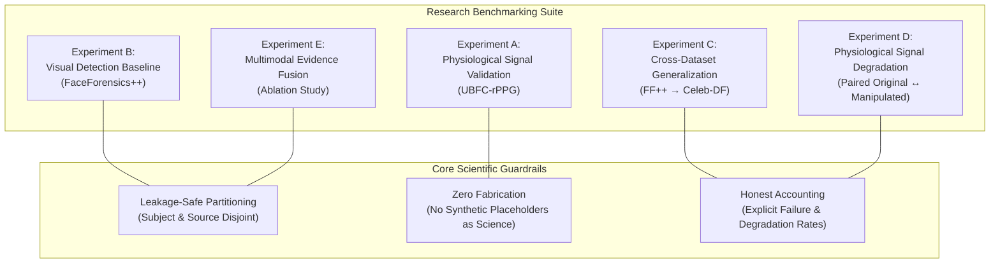

# BIOTrace — Stage 8: Real-World Dataset Validation & Research Experiments

**Document Status:** Official Research Strategy & Experimental Framework Specification  
**Classification:** Academic, Biomedical & Computer Vision Methodology  
**Epistemological Mandate:** Strict Separation of Engineering Verification from Empirical Scientific Results  

---

## 1. Executive Research Overview

BIOTrace has transitioned from an engineering prototype to a reproducible, leakage-safe experimental research platform. Rather than attempting to manufacture artificially high detection accuracy on unverified data, the Stage 8 framework is designed to discover what works, what fails, and whether physiological observations provide meaningful, complementary evidence for assessing video integrity.

---

## 2. Experimental Status & Scientific Distinctions

A fundamental ethical requirement of this research is the transparent distinction between **engineering software verification** and **empirical scientific results**.

| Experiment Identifier | Target Benchmark | Primary Scientific Question | Current Operational Status | Scientific Finding / Obstacle |
| :--- | :---: | :--- | :---: | :--- |
| **Experiment A** (Physiological Validation) | UBFC-rPPG | Does rPPG (CHROM/POS) accurately track cardiac frequency against reference contact PPG? | `AWAITING_DATASET_ACCESS` | Awaiting institutional data agreement; software pipeline verified on synthetic fixtures. |
| **Experiment B** (Visual Detection Baseline) | FaceForensics++ (c23/c40) | What are the baseline AUROC, AP, and EER of the visual CNN under identity-safe partitioning? | `AWAITING_DATASET_ACCESS` | Requires official TUM Google Form terms agreement; weights and data not yet downloaded. |
| **Experiment C** (Cross-Dataset Generalization) | FF++ $\rightarrow$ Celeb-DF v2 | How severely does visual classifier performance degrade when tested out-of-domain without retraining? | `AWAITING_DATASET_ACCESS` | Dependent on Experiment B in-domain baseline and Celeb-DF authorization. |
| **Experiment D** (Physiological Degradation) | FF++ (Paired) | How does facial manipulation affect optical cardiovascular SNR and landmark continuity? | `AWAITING_DATASET_ACCESS` | Paired source-video mapping designed; pending FF++ acquisition. |
| **Experiment E** (Multimodal Fusion) | FF++ / Multimodal | Does combining visual features with physiological evidence improve decision robustness? | `AWAITING_DATASET_ACCESS` | Multi-tiered ablation engine ready; awaiting real benchmark ingestion. |
| **Engineering Verification** | Local Unit Test Suite | Are manifest hashing, duplicate detection, splitting, and metric calculations mathematically correct? | **COMPLETED & VERIFIED** | 100% test pass rate across 230+ Python tests and 25 Java tests. |

---

## 3. Experimental Protocols & Methodologies

### 3.1 Experiment A — Physiological Signal Validation (UBFC-rPPG)
* **Objective:** Quantify the error and correlation of BIOTrace's CHROM and POS algorithms against synchronized contact pulse oximeter waveforms (Contec CMS50E).
* **Reference Metrics:**
  - $\text{MAE} = \frac{1}{N} \sum_{i=1}^N |\hat{y}_i - y_i|$ (Mean Absolute Error in BPM).
  - $\text{RMSE} = \sqrt{\frac{1}{N} \sum_{i=1}^N (\hat{y}_i - y_i)^2}$ (Root Mean Squared Error in BPM).
  - $\text{Bias} = \frac{1}{N} \sum_{i=1}^N (\hat{y}_i - y_i)$ (Mean Error in BPM).
  - $\text{SD of Error} = \sqrt{\frac{1}{N-1} \sum_{i=1}^N (e_i - \bar{e})^2}$ (Precision).
  - Pearson correlation ($r$) and statistical p-value.
  - Valid-estimation coverage ratio (fraction of windows with SNR $\ge 1.0$ dB).
* **Synchronization Protocol:** Sliding temporal analysis windows ($1.6$s window, $0.5$s stride) aligned strictly with synchronized reference timestamps from `ground_truth.txt`. Unaligned timestamps or interpolated gaps are rejected.
* **Cautionary Notice:** High Pearson correlation reflects frequency covariance, not clinical or diagnostic equivalence.

### 3.2 Experiment B — Visual Deepfake Detection Baseline (FaceForensics++)
* **Objective:** Establish an empirical baseline for visual classification using raw logits and temporal score aggregation on held-out test videos.
* **Leakage-Safe Partitioning:** Partitioned strictly at the **source-video level** (`source_video_id`). All manipulated versions (Deepfakes, Face2Face, FaceSwap, NeuralTextures) originating from source video $X$ are sequestered in the same partition as the authentic source video.
* **Metrics Computed:**
  - AUROC (Area Under the ROC Curve).
  - Average Precision (area under Precision-Recall curve).
  - Equal Error Rate (EER) where $\text{FPR} = \text{FNR}$.
  - Confusion matrix ($\text{TN}, \text{FP}, \text{FN}, \text{TP}$) at optimal ROC threshold.
  - Extreme error cases (top false positives and false negatives).
* **Scientific Guardrail:** Sigmoid transformed scores are documented as uncalibrated continuous model outputs, never as objective probabilities of authenticity.

### 3.3 Experiment C — Cross-Dataset Generalization
* **Objective:** Measure empirical performance collapse when a model trained on FaceForensics++ is tested on Celeb-DF v2 without retraining or threshold adjustment.
* **Generalization Metrics:**
  - $\Delta \text{AUROC} = \text{AUROC}_{\text{target}} - \text{AUROC}_{\text{source}}$.
  - $\Delta \text{EER} = \text{EER}_{\text{target}} - \text{EER}_{\text{source}}$.
* **Domain Shift Factors:** Systematically catalog differences in synthesis architectures, compression artifacts (c23 vs standardized H.264), camera sensors, and subject demographic distributions.
* **Guardrail:** A random train/test split within the same dataset is strictly prohibited from being labeled "cross-dataset validation".

### 3.4 Experiment D — Physiological Evidence Under Manipulation
* **Objective:** Investigate whether optical cardiovascular signals (rPPG), facial dynamics (blink kinetics), and spatial biological consistency are preserved, attenuated, or corrupted in deepfakes compared to their pristine originals.
* **Comparative Design:**
  - Identify matched pairs $(V_{\text{auth}}, V_{\text{manip}})$ sharing identical `source_video_id`.
  - Extract rPPG and compute SNR drop: $\Delta \text{SNR} = \text{SNR}_{\text{auth}} - \text{SNR}_{\text{manip}}$.
  - Compute spatial biological consistency correlation drop: $\Delta r_{\text{spatial}}$.
  - Measure the rate of physiological signal unobservability (`UNAVAILABLE_SIGNAL` or `DEGRADED`).
* **Forensic Caveat:** Signal attenuation or phase decorrelation under manipulation reflects temporal warping and pixel blending artifacts. It does **not** prove manipulation in isolation, as heavy compression or sensor noise can induce similar degradation.

### 3.5 Experiment E — Multimodal Evidence Evaluation & Ablation
* **Objective:** Test whether combining visual CNN classifications with physiological consistency evidence improves decision robustness compared to visual classification alone.
* **Ablation Configurations:**
  1. *Visual-Only Baseline:* Frame-level CNN aggregated across temporal windows.
  2. *Physiological-Only Baseline:* Evaluation of rPPG SNR, spatial phase coherence, and blink kinetics.
  3. *Fused Evidence:* Transparent evidence moderation where borderline visual detections are evaluated alongside physiological signal quality.
* **Scientific Accountability:** If fusion fails to outperform visual classification alone (e.g. if compression ruins rPPG across both real and fake videos), the result is documented candidly, providing valuable empirical research on the limitations of multimodal deepfake forensics.

---

## 4. Cryptographic Provenance & Anonymization Architecture

To ensure strict scientific reproducibility and preserve forensic integrity:
1. **Manifest Content Hashing:** All dataset records are sorted canonically by `record_id` and hashed using SHA-256 (`DatasetManifest.compute_manifest_hash`). Any alteration to video files or labels immediately changes the manifest hash.
2. **Split Provenance Hashing:** Partition allocations are content-hashed (`DatasetSplitManifest.compute_split_hash`), ensuring complete traceability back to random seeds and source splits.
3. **Model Checkpoint Digests:** Experiment logs embed the SHA-256 digest of loaded neural network weights.
4. **Filesystem Path Masking:** Absolute paths (e.g. `C:\Users\Username\...`) are sanitized to relative dataset paths (`FaceForensics++/manipulated_sequences/...`), preventing identity leakage in published artifacts.

---

## 5. Next Steps for Empirical Data Acquisition

1. Review and approve the licensing and access requirements in [`research/datasets/DATASET_ACCESS_AUDIT.md`](file:///c:/Users/Sravya%20mummana/OneDrive/BioTrace/research/datasets/DATASET_ACCESS_AUDIT.md).
2. Authorize institutional application submissions for **UBFC-rPPG** (Experiment A) and **FaceForensics++** (Experiments B, D, E).
3. Upon approval and download to the secure `datasets/` directory, invoke `ManifestBuilder` and `ResearchExperimentRunner` to execute live empirical benchmarks.
